<!-- Tema: o mesmo do portfolio (fundo #141413, acento #d97757, pixel). Os SVGs em assets/ sao gerados por assets/build.mjs. -->

<p align="center">
  <a href="https://portfolio-breno-oliveira.netlify.app/">
    
  </a>
</p>

<p align="center">
  <a href="https://portfolio-breno-oliveira.netlify.app/"></a>
  <a href="https://www.linkedin.com/in/brenool1veira/"></a>
  <a href="https://www.youtube.com/@obrenin_dev"></a>
  <a href="https://www.tiktok.com/@obrenin.dev"></a>
  <a href="https://www.instagram.com/obrenin.dev/"></a>
  <a href="mailto:brenojuandeoliveirapinto@gmail.com"></a>
</p>

```console
guest@obrenin.dev ~ $ whoami
Breno Juan de Oliveira
Systems Analyst · Data Engineer · Data Scientist · Data Architect

guest@obrenin.dev ~ $ cat about.txt
Data-focused Systems Analyst specialized in Big Data ecosystems, data engineering,
analytics and scalable data architectures. Passionate about building modern data
platforms, optimizing pipelines and transforming data into strategic assets.

guest@obrenin.dev ~ $ ls overview/
end-to-end-data-lifecycle/     scalable-data-architecture/    data-pipelines/
analytics-and-bi/              applied-data-science/          cloud-and-distributed/
cicd-and-dataops/
```

## ■ STACK

<p>
  
  
  
  
  
  
  
  
  
</p>

## ■ SKILLS

<table>
  <tr>
    <td valign="top" width="50%">
      <b>▸ DATA ENGINEERING</b>
      <ul>
        <li>ETL / ELT development</li>
        <li>Batch and stream processing</li>
        <li>Data pipeline orchestration</li>
        <li>Data transformation &amp; cleansing</li>
        <li>Distributed data processing (Spark)</li>
        <li>Big Data ecosystems (Hadoop)</li>
        <li>Workflow automation (Airflow)</li>
        <li>Data integration (APIs, ERP, XML, databases)</li>
        <li>Query optimization &amp; performance tuning</li>
        <li>Data versioning &amp; reproducibility</li>
      </ul>
    </td>
    <td valign="top" width="50%">
      <b>▸ DATA ARCHITECTURE</b>
      <ul>
        <li>Relational and dimensional modeling</li>
        <li>Data warehousing concepts</li>
        <li>Star &amp; Snowflake schema</li>
        <li>Data governance awareness</li>
        <li>Data quality strategies</li>
        <li>Metadata management</li>
        <li>Structured &amp; semi-structured data handling</li>
      </ul>
    </td>
  </tr>
  <tr>
    <td valign="top">
      <b>▸ DATA ANALYTICS</b>
      <ul>
        <li>Exploratory Data Analysis (EDA)</li>
        <li>KPI definition &amp; business metrics</li>
        <li>Data visualization &amp; dashboards</li>
        <li>Business intelligence modeling</li>
        <li>SQL-based analytical querying</li>
        <li>Data storytelling</li>
      </ul>
    </td>
    <td valign="top">
      <b>▸ DATA SCIENCE</b>
      <ul>
        <li>Statistical analysis</li>
        <li>Predictive modeling</li>
        <li>Feature engineering</li>
        <li>Data preprocessing</li>
        <li>Machine learning fundamentals</li>
        <li>Model evaluation &amp; validation</li>
        <li>Pandas, NumPy, Scikit-learn</li>
      </ul>
    </td>
  </tr>
  <tr>
    <td valign="top">
      <b>▸ BIG DATA &amp; CLOUD</b>
      <ul>
        <li>Hadoop ecosystem</li>
        <li>Apache Spark</li>
        <li>Distributed storage concepts</li>
        <li>Data Lakes &amp; Data Warehouses</li>
        <li>Cloud-based data pipelines</li>
        <li>Scalable storage strategies</li>
      </ul>
    </td>
    <td valign="top">
      <b>▸ DATAOPS &amp; CI/CD</b>
      <ul>
        <li>CI/CD pipelines for data workflows</li>
        <li>Git-based version control</li>
        <li>Automated deployment strategies</li>
        <li>Testing data pipelines</li>
        <li>Monitoring and observability</li>
        <li>Workflow scheduling</li>
      </ul>
    </td>
  </tr>
</table>

## ■ CURRENT FOCUS

```console
guest@obrenin.dev ~ $ tail focus.log
[ ON ] advanced distributed data processing
[ ON ] scalable data architectures
[ ON ] modern data stack evolution
[ ON ] cloud-native data engineering
[ ON ] end-to-end dataops practices
```

## ■ GITHUB

<p align="center">
  
  
</p>

<p align="center">
  
</p>

<p align="center">
  
</p>

<p align="center">
  
</p>
